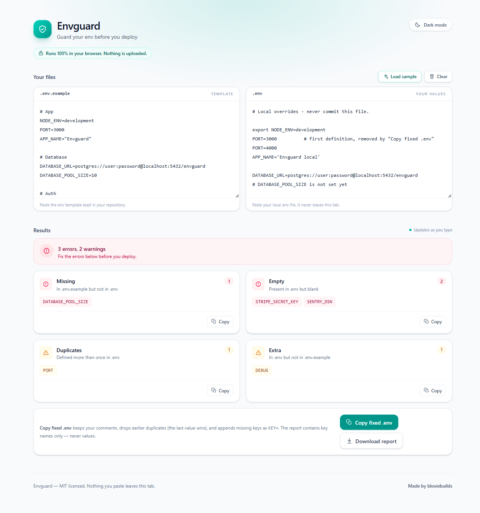

# Envguard

**Guard your env before you deploy.**

[](./LICENSE)
[](https://react.dev)
[](https://vite.dev)
[](https://www.typescriptlang.org)
[](https://tailwindcss.com)

Envguard is a tiny browser tool that compares your `.env.example` with your `.env` and tells you what is wrong before you deploy. Paste both files and it instantly finds missing keys, blank values, duplicates, and stray variables. Everything runs locally in the browser, so your secrets never leave the tab.

## Live demo

Try it at [https://YOUR-DEPLOY-URL](https://YOUR-DEPLOY-URL).



## Features

- Live results as you type — no submit button
- Missing, empty, duplicate, and extra key checks
- Copy a fixed `.env` with missing keys appended and duplicates removed
- Download a plain-text report
- Dark mode that follows your system preference
- 100% private — nothing is uploaded or stored
- No sign-up, no accounts, no tracking

## How it works

1. Paste your `.env.example` on the left.
2. Paste your `.env` on the right.
3. Read the results — every issue is listed by key name, with a copy button.

## What it checks

| Check | Meaning | Severity |
| --- | --- | --- |
| Missing | Key is in `.env.example` but not in `.env` | Error |
| Empty | Key exists in `.env` but its value is blank | Error |
| Duplicates | Key appears more than once in `.env` | Warning |
| Extra | Key is in `.env` but not in `.env.example` | Warning |

Envguard understands `export KEY=value`, single- and double-quoted values, and inline `# comments`. Blank lines and comment lines are ignored.

## Run locally

```bash
git clone https://github.com/bloxiebuilds/envguard
cd envguard
npm install
npm run dev
```

Open the URL Vite prints (usually `http://localhost:5173`).

## Deploy

Envguard is a static site, so it works on Vercel or Netlify with zero config:

- Build command: `npm run build`
- Output directory: `dist`

## Privacy

Your env files are parsed in memory and never sent anywhere. There is no backend, no database, no analytics, and no `localStorage` — nothing you paste is saved, and reloading the page clears it.

## Contributing

Fork the repo, create a branch for your change, and open a pull request. Small, focused PRs are easiest to review.

## License

[MIT](./LICENSE)

Made by [bloxiebuilds](https://github.com/bloxiebuilds)
